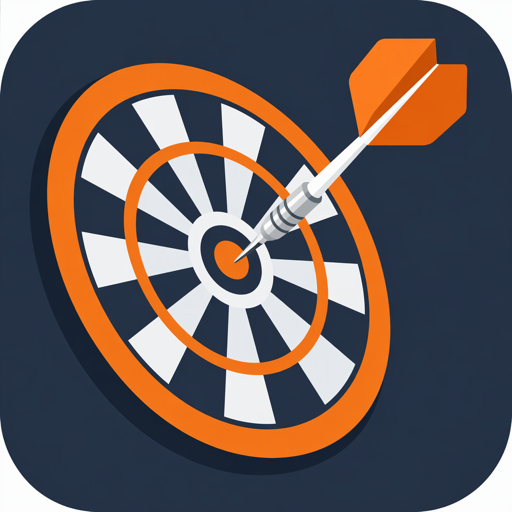

# Darts Scorebook

Дартс — минималистичный счётчик очков для Android.

## Версия 1.8

- Офлайн-режим: играйте без интернета — результаты сохраняются на телефоне и синхронизируются, когда сеть вернётся
- Гостевой режим без аккаунта
- Пять языков: русский, английский, испанский, китайский, хинди

## Установка

1. Скачайте APK: [darts-1.8.apk](https://github.com/aldebogdanov/darts/releases/download/v1.8.0/darts-1.8.apk)
2. Откройте файл на телефоне. Если система спросит — разрешите установку из этого источника
   (Настройки → Безопасность → Установка неизвестных приложений → браузер или файловый менеджер).
3. Установите и запустите. Вход через Google не обязателен: можно играть гостем, все данные останутся на телефоне.

Нужен Android 8.0 или новее.

Сайт: https://darts.michelada.uno
